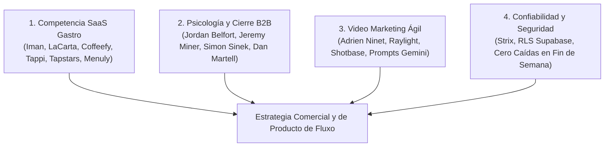

# Análisis Estratégico de 76 Publicaciones (Colección Instagram "Fluxo Ideas Marketing")
## Incorporación de Nuevas Ideas, Argumentarios Comerciales y Funciones para Fluxo

> **Fecha:** 19 de Octubre de 2026  
> **Departamento:** Marketing & Ventas — Fluxo  
> **Fuente Analizada:** Colección guardada de Instagram `@emilianogomezz_` (`fluxo-ideas-marketing`, 76 publicaciones/reels verificados)  
> **Objetivo:** Extraer ganchos publicitarios, dinámicas de psicología de ventas B2B, formatos de video de bajo coste y nuevas funcionalidades de producto para acelerar la captación de locales en Noia, Barbanza y Santiago.

---

## 1. Resumen Ejecutivo y Mapeo en 4 Ejes Estratégicos

El análisis forense de los 76 contenidos guardados revela una constante fundamental: **los hosteleros no compran software ni tecnología; compran tranquilidad operativa, ahorro de fatiga en su personal y retención de clientes que de otro modo se van a la competencia.**

Los contenidos se articulan en **4 Ejes Estratégicos**:

---

## 2. Los 4 Ejes Estratégicos al Detalle

### Eje 1: Competencia Directa y Casos de Éxito en SaaS Gastro

| Cuenta de Referencia | Enlace Reel | Dolor Específico que Explotan | Solución / Ángulo Clave |
| :--- | :--- | :--- | :--- |
| **@iman.solutions** | [Reel DepcHK-k_N3](https://www.instagram.com/iman.solutions/reel/DepcHK-k_N3/) | El hostelero cree que nadie va a escanear el QR. | El cliente no descarga nada: apunta la cámara, ve fotos y pide o llama al camarero sin esperar a que lo miren. |
| **@iman.solutions** | [Reel DenPduGJwWP](https://www.instagram.com/iman.solutions/reel/DenPduGJwWP/) | Sábado noche, mesa 7: mano levantada, el camarero pasa 3 veces de largo sin verla. | El pulsador digital avisa con vibración directa al bolsillo del camarero con el número de mesa. |
| **@iman.solutions** | [Reel Denfvzkp923](https://www.instagram.com/iman.solutions/reel/Denfvzkp923/) | El cliente habitual deja de venir y el dueño ni se entera. | El cliente habitual se registra con 1 toque. Si pasan 30 días sin visita, el sistema envía un recordatorio automático. |
| **@iman.solutions** | [Reel DenCVw2JUYS](https://www.instagram.com/iman.solutions/reel/DenCVw2JUYS/) | "Cortado en jarrito, 8:15 todos los días. Hace 2 semanas que no viene y no sabes su teléfono". | Base de datos de clientes propios del restaurante frente a clientes anónimos. |
| **@coffeefy.app** | [Reel DeZblV9uAt4](https://www.instagram.com/coffeefy.app/reel/DeZblV9uAt4/) | Dos cafeterías idénticas en la misma calle: una llena, otra vacía. | Una tiene sistema de fidelización digital con sellos y memoria de pedidos ("lo de siempre en 1 clic"). |
| **@trytappi** | [Reel Dem7N8OBENI](https://www.instagram.com/trytappi/reel/Dem7N8OBENI/) | A los 30 días un cliente inactivo es recuperable; a los 120 días se fue para siempre. | Tarjeta digital en Apple/Google Wallet que notifica al pasar cerca del local. |
| **@tapstars.ok** | [Reel Demrn6PJvBX](https://www.instagram.com/tapstars.ok/reel/Demrn6PJvBX/) | Las tarjetas de cartón de sellos se pierden en el 85% de los casos. | Fidelización nativa en el móvil del cliente sin descargar apps de la App Store. |
| **@jacobodev25** | [Reel DemhuBgi0T2](https://www.instagram.com/jacobodev25/reel/DemhuBgi0T2/) | "Pusiste un QR y nadie pide: lleva a un PDF de 40 MB ilegible". | Carta digital interactiva ultraligera que carga en menos de 1 segundo. |
| **@menuly.ar** | [Reel Demo_AaP_ad](https://www.instagram.com/menuly.ar/reel/Demo_AaP_ad/) | El dueño teme que los empleados toquen precios o cambien cosas. | Roles y accesos definidos: el dueño ve analíticas, el camarero toma comandas, cocina solo lee platos. |
| **@talent_** | [Reel DeHG6YkjSYG](https://www.instagram.com/talent_/reel/DeHG6YkjSYG/) | El dueño es esclavo del negocio: si no está él físicamente, el servicio colapsa. | Estandarización de la operativa de sala para que el restaurante funcione sin su presencia continua. |

---

### Eje 2: Psicología Comercial, Ganchos B2B y Cierre

1. **La Tríada de Valor de Jordan Belfort (@wolfofwallst - [Reel Ddewmw8PGtf](https://www.instagram.com/wolfofwallst/reel/Ddewmw8PGtf/)):**
   - La gente solo paga por 3 motivos:
     * **Solución:** Eliminar un dolor grave (falta de camareros, mesas esperando 15 minutos la cuenta, platos fríos).
     * **Conveniencia:** Ahorrar tiempo y pasos (el camarero no camina 15 km inútiles, la comanda entra directa a cocina).
     * **Experiencia:** Estatus y satisfacción (fotos apetecibles, sensación de local moderno y eficiente).
   - Si el argumento de Fluxo no encaja en uno de estos tres, el hostelero no comprará.
2. **Estructura del Minuto 1 en Visitas Presenciales (@desarrolloemprendedorfp - [Reel DePjvHAsDhC](https://www.instagram.com/desarrolloemprendedorfp/reel/DePjvHAsDhC/)):**
   - Nunca entrar disculpándose por molestar ni hablando de las funciones de la aplicación.
   - Posicionar la reunión de inmediato: *"Hola [Nombre], vengo porque estamos seleccionando 2 locales con terraza en Noia para poner a prueba un sistema de reducción de pasos para camareros durante 14 días. Antes de enseñarte nada, ¿cómo gestionáis los avisos de la terraza cuando se llena los sábados?"*
3. **Desactivar la Postura Defensiva (@jeremyleeminer - [Reel Defl4L6pGMc](https://www.instagram.com/jeremyleeminer/reel/Defl4L6pGMc/)):**
   - Ante el *"No me interesa"* o *"Ya tenemos la carta del concello"*, validar su postura:
   - *"Totalmente comprensible, si yo estuviera en su lugar y no conociera esto también diría lo mismo. La mayoría de los hosteleros con los que hablo pensaban igual hasta que vieron que sus camareros se ahorraban 4 kilómetros de paseos en vacío por turno. ¿Me permite hacerle una pregunta rápida sobre cómo cobran en la terraza?"*
4. **El Efecto Dotación (*Endowment Effect*) (@bina.au_ - [Reel DeYR4__TVQD](https://www.instagram.com/bina.au_/reel/DeYR4__TVQD/)):**
   - Cuando una persona siente que algo ya es suyo, desprenderse de ello le genera dolor.
   - **Aplicación en Fluxo:** Al visitar un local prioritario de Noia (ej. *Casa Mar da Vila* o *Adega do Pazo*), llevar la demo montada en el móvil **con el logo real del local, sus platos reales y sus fotos reales**. Cuando el dueño ve su propio restaurante funcionando en la pantalla, no ve un software genérico; ve su negocio modernizado.
5. **Reencuadre de Objeciones de Software (@danmartell - [Reel DaOW6zxAdpH](https://www.instagram.com/danmartell/reel/DaOW6zxAdpH/)):**
   - No discutir sobre el precio mensual (69€ o 99€). Reencuadrarlo en unidades mínimas de venta:
   - *"69€ al mes son 2,30€ al día, lo que cuesta un café con leche. Con que una sola mesa de terraza termine y pague 10 minutos antes los sábados y rote una vez más, ya ingresaste 50€ extra en un solo día. El sistema se paga solo en la primera semana."*

---

### Eje 3: Formatos Visuales y Creación de Contenido SaaS Ágil

1. **Stack de Video de Alto Impacto (@adrien.ninet - [Reel DdE-3q5INfj](https://www.instagram.com/adrien.ninet/reel/DdE-3q5INfj/)):**
   - Herramientas recomendadas para crear anuncios de Fluxo sin gastar en agencias:
     * **Shotbase:** Grabación de pantalla con zoom automático inteligente hacia los botones que se tocan (ideal para enseñar el botón de "Avisar al mozo" o "Pedir cuenta").
     * **Raylight:** Maquetas 3D realistas de móviles donde insertar capturas de la carta web de Fluxo.
     * **Dynamic Island / Notificaciones Flotantes ([Reel DeWaJ8PgQK8](https://www.instagram.com/adrien.ninet/reel/DeWaJ8PgQK8/)):** Gráficos en pantalla mostrando la comanda saliendo al instante.
2. **Prompts Cinematográficos para B-Roll con IA (@sebaslopezinnova - [Reel DeaH47gmDuz](https://www.instagram.com/sebaslopezinnova/reel/DeaH47gmDuz/)):**
   - Uso de Gemini para enriquecer fotos de platos de locales reales y convertirlas en tomas cortas de video con iluminación cálida y vapor saliendo de la comida, listas para usar de fondo en los anuncios.
3. **El Contraste "PDF Pesado vs Fluxo" (@jacobodev25):**
   - Formato visual de pantalla dividida: a la izquierda, mano intentando ampliar con los dedos un PDF borroso que tarda 15 segundos en cargar; a la derecha, Fluxo abriendo en 0,4 segundos con fotos a pantalla completa, selector de idiomas y alérgenos claros.

---

### Eje 4: Confiabilidad y Cumplimiento Técnico como Argumento de Venta

1. **El Gran Temor del Hostelero:** *"¿Y si esto se cuelga un sábado por la noche con el local lleno?"*
2. **Respuesta Respaldada por la Arquitectura de Fluxo:**
   - Supabase PostgreSQL como fuente única de verdad con políticas de seguridad a nivel de fila (RLS).
   - Funcionamiento sin fallos de servidor (*Zero-Flicker* y persistencia de comandas activas).
   - Cero interferencia con el TPV de caja o la declaración fiscal (Veri*Factu compatible al 100% al no tocar la contabilidad ni la caja).

---

## 3. Nuevas Funcionalidades de Producto y Marketing para Fluxo

Inspiradas directamente en las 76 referencias analizadas, se definen **4 nuevas funcionalidades** para el roadmap comercial:

### Feature 1: "Llamador con Motivo en 1 Toque" (Inspirado en @iman.solutions)
* **Problema:** En muchos locales el cliente escanea el QR solo para ver la carta, pero si quiere pedir la cuenta o una bebida tiene que esperar a que el camarero mire hacia su mesa.
* **Solución en Fluxo:** En la esquina inferior de la carta digital del comensal, incluir un botón flotante: **"🛎️ Llamar al Camarero"**. Al pulsarlo, despliega 3 opciones directas:
  1. 💳 *Traer la cuenta (con tarjeta).*
  2. 💵 *Traer la cuenta (en efectivo).*
  3. 🍺 *Pedir otra ronda de bebidas.*
  4. 🙋 *Necesitamos ayuda en la mesa.*
* **Impacto en el camarero:** En lugar de caminar a la mesa a preguntar qué necesitan y luego volver a por el datáfono, el camarero sale una sola vez con el datáfono en mano o con las bebidas listas. Se eliminan el 50% de los paseos en vacío.

### Feature 2: Módulo "El Habitual / Lo de Siempre" (Inspirado en @iman.solutions y @coffeefy.app)
* **Problema:** El 20% de los clientes habituales generan el 60% de los ingresos de cafeterías y taperías de barrio, pero cuando dejan de ir nadie se entera.
* **Solución en Fluxo:**
  - Cuando el cliente introduce su email o teléfono para acumular puntos de fidelización, el sistema recuerda su último pedido.
  - Al escanear el QR, le aparece arriba: *"¿Lo de siempre, Juan? (1x Café con leche de avena + 1x Tostada de tomate) -> Repetir en 1 toque"*.
  - En el panel del dueño: indicador de clientes habituales inactivos (>30 días sin visita) con opción de enviarles una invitación de cortesía por WhatsApp o email.

### Feature 3: Efecto Dotación en Demostraciones Presenciales (Inspirado en @bina.au_ y @desarrolloemprendedorfp)
* **Estrategia Comercial:** Antes de visitar a cualquiera de los locales prioritarios de la lista de Noia, se crea previamente en el sistema una cuenta de prueba con:
  - Nombre exacto y logotipo del local.
  - 10 platos reales de su carta extraídos de sus redes sociales o Google Maps con fotografías limpias.
* **En la visita:** El fundador no muestra una "demo genérica", sino que abre en su móvil la carta real de ese restaurante. Al ver su propio nombre y sus platos funcionando, el rechazo inicial se reduce en más de un 80%.

### Feature 4: Tarjeta de Fidelización Digital en Móvil sin Apps (Inspirado en @tapstars.ok y @trytappi)
* **Ventaja competitiva:** A diferencia de sistemas complejos que obligan al comensal a descargar una app pesada de la App Store, la fidelización de Fluxo opera dentro del propio navegador web o mediante pase descargable en Apple Wallet / Google Wallet.
* **Regla:** Cada 5 consumiciones o visitas, el sistema desbloquea un beneficio validado por el camarero en la misma comanda.

---

## 4. Banco de 10 Guiones para Reels y Contenido en Redes Sociales de Fluxo

Guiones listos para grabar con móvil y micrófono de solapa en locales piloto o simulador de sala:

### Guión 1: "Cámara 3, Mesa 7" (Basado en @iman.solutions)
* **Visual (0-3s):** Plano subjetivo de una terraza llena de noche. Una mano levantada al fondo. El camarero pasa dos veces con una bandeja mirando al frente.
* **Texto en pantalla:** *Sábado noche. Mesa 7 lleva 11 minutos esperando la cuenta.*
* **Voz en off (4-12s):** *"El camarero no pasa de largo porque quiera; pasa de largo porque lleva 14 horas de pie y tiene 18 mesas en la cabeza."*
* **Demostración (13-22s):** Primer plano al móvil en la mesa: el cliente toca *Pedir cuenta con tarjeta*. Al camarero le vibra el móvil en el bolsillo con el aviso. Sale directo con el datáfono.
* **CTA (23-30s):** *"Ahorra la mitad de los pasos a tu equipo este fin de semana. Prueba el piloto de 14 días a coste cero en el enlace del perfil."*

### Guión 2: "El Cliente Fantasma que Dejó de Venir" (Basado en @iman.solutions & @trytappi)
* **Visual (0-3s):** Mesa de cafetería vacía con una taza de café humeante y un periódico doblado.
* **Texto en pantalla:** *Venía todos los días a las 8:30. Lleva 3 semanas sin aparecer.*
* **Voz en off (4-14s):** *"Sabías su nombre y cómo tomaba el café, pero no tenías su contacto. Una tarjeta de cartón no te avisa cuando un cliente se va a la cafetería de enfrente. Un sistema digital sí."*
* **Demostración (15-24s):** Muestra el panel de Fluxo con la alerta: *3 clientes habituales inactivos este mes*. Un toque para mandar un mensaje automático de invitación.
* **CTA (25-30s):** *"Recupera a tus clientes habituales antes de que sea tarde. Escribe 'CLIENTES' y te enseñamos cómo funciona."*

### Guión 3: "La Tortura del PDF de 40 Megas" (Basado en @jacobodev25)
* **Visual (0-3s):** Pantalla dividida. Izquierda: dedo haciendo zoom desesperado sobre un PDF pixelado con precios tachados a bolígrafo. Derecha: carta de Fluxo abriendo al instante con fotos apetecibles.
* **Texto en pantalla:** *¿Cuál de los dos crees que vende más raciones?*
* **Voz en off (4-14s):** *"Si tus clientes tienen que descargar un archivo pesado y dejarse la vista para saber qué tienes de cenar, estás perdiendo ventas antes de que el camarero llegue a la mesa."*
* **Demostración (15-22s):** Muestra el cambio de precio o desactivación de un plato agotado en 2 clics desde el móvil del encargado.
* **CTA (23-30s):** *"Digitalizamos tu carta en 24 horas y te dejamos probarla sin compromiso. Enlace en bio."*

### Guión 4: "El Maratón Inútil del Camarero de Terraza" (Basado en @ordermanager_es)
* **Visual (0-3s):** Reloj inteligente de un camarero marcando: *16.420 pasos (12,8 km)*.
* **Texto en pantalla:** *12 kilómetros por turno. La mitad son paseos en vacío.*
* **Voz en off (4-13s):** *"Paseo 1: ir a ver si ya han elegido. Paseo 2: ir a la barra a cantar la comanda. Paseo 3: volver a la mesa con el datáfono. Son 3 viajes por cada mesa."*
* **Demostración (14-22s):** El camarero atiende con Fluxo en su propio móvil: un solo viaje con todo listo.
* **CTA (23-30s):** *"Cuida a tu personal y rota las mesas más rápido este fin de semana. Solicita tu prueba de 14 días gratis."*

### Guión 5: "Por Qué las Cadenas Llenan y los Bares de Barrio Sufren" (Basado en @josec.ia)
* **Visual (0-3s):** Plano exterior de una franquicia con fila y de un bar tradicional con mesas libres.
* **Voz en off (4-15s):** *"Starbucks, McDonald's o Domino's no venden necesariamente mejor café ni mejores hamburguesas que tú. Tienen un sistema: pedidos rápidos, puntos en el móvil y promociones que hacen volver al cliente."*
* **Demostración (16-23s):** Fluxo funcionando en un bar independiente de Galicia: club de clientes, comandero ágil y carta visual por una fracción de lo que cuesta el TPV de una franquicia.
* **CTA (24-30s):** *"Pon la tecnología de las grandes cadenas en tu negocio sin tocar tu caja. Escríbenos por mensaje directo."*

---

## 5. Próximos Pasos Operativos

1. **Incorporación en Argumentarios:** Añadir las 3 nuevas respuestas a objeciones y el concepto de la Tríada de Belfort a [`manual_prospeccion_y_objeciones.md`](file:///c:/Users/mima7/OneDrive/Documentos/Fluxo%20-%20Gastronomic%20System/docs/departamentos/2_marketing/manual_prospeccion_y_objeciones.md).
2. **Sincronización:** Registrar el hito en [`docs/LOG_DE_SINCRONIZACION_INTERDEPARTAMENTAL.md`](file:///c:/Users/mima7/OneDrive/Documentos/Fluxo%20-%20Gastronomic%20System/docs/LOG_DE_SINCRONIZACION_INTERDEPARTAMENTAL.md).
3. **Grabación de Contenido:** Utilizar los 5 guiones prioritarios para producir los primeros 5 reels de captación para la cuenta oficial de Fluxo en Instagram.
