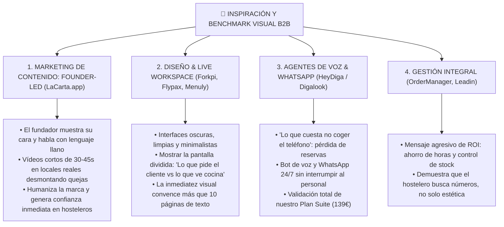

# 🔍 BENCHMARK DE REDES & TENDENCIAS VISUALES: INSTAGRAM & AGENTES IA
> **Departamento:** Marketing & Ventas  
> **Fecha:** 2026-10-13  
> **Fuentes Analizadas:** OrderManager, Leadin Business, Flypax, Forkpi, LaCarta App, Menuly y HeyDiga (Digalook).

---

---

## 1. Análisis Específico de las Cuentas

### ⭐ La Estrella de Marketing: `@lacarta.app` (El Enfoque "Founder-Led Content")
* **Por qué funciona tan bien:**
  * **La cara del fundador:** El creador se graba en primera persona, va a bares reales, habla con hosteleros y explica los problemas sin lenguaje corporativo ni tecnicismos.
  * **Contenido de fricción real:** Muestra lo que pasa cuando una carta en PDF no carga, cuando el menú cambia de precio y hay que tachar con bolígrafo, o cómo un plato con vídeo vende el triple.
  * **Lección para Fluxo:** **El fundador como motor de ventas.** Un vídeo de Emiliano en una terraza de Noia con un teléfono en la mano diciendo: *"Mira lo que pasa cuando el cliente pide la cuenta con tarjeta desde aquí... al camarero le vibra esto y sale directo con el datáfono. Cero viajes dobles"* tiene 10 veces más impacto que un anuncio genérico.

---

### ⚡ `@forkpi` & `@flypaxapp`: La Elegancia del "Live Workspace"
* **Qué hacen bien:**
  * Vídeos de producto ultra-dinámicos con pantallas sincronizadas.
  * Muestran en un solo plano el móvil del cliente haciendo un pedido y la tablet de cocina recibiéndolo en 0,2 segundos.
* **Lección para Fluxo:** En nuestros reels y vídeos de TikTok/Instagram para Galicia, debemos mostrar la **pantalla dividida (Split Screen)**:
  * *Lado izquierdo:* El cliente en la terraza de Noia pulsando "Pedir Cuenta con Tarjeta".
  * *Lado derecho:* El móvil del camarero en la barra vibrando con la alerta en azul y saliendo directo con el datáfono.

---

### 🇦🇷 `@menuly.ar`: Cartas con Foco en Autogestión y Simplicidad
* **Qué hacen bien:**
  * Enfoque en resolver la pesadilla de actualizar precios y menús del día en dos toques desde el móvil.
* **Lección para Fluxo:** Conexión directa con nuestra **Versión 1.2 (Menú del día autogestionable en 2 clics)**. El mensaje: *"Cambia el menú del día de las 13:00 en 30 segundos desde tu propio WhatsApp o panel sin imprimir papeles"*.

---

### 🤖 HeyDiga (`heydiga.com/es/productos/digalook`): Agente IA para Teléfono y WhatsApp
* **Qué hacen:**
  * Desarrollan recepcionistas de IA por voz y WhatsApp para que ningún negocio pierda una cita o reserva mientras tiene las manos ocupadas.
  * **Copywriting demoledor que debemos tomar como referencia:**  
    > *"Lo que cuesta no coger el teléfono: Cada llamada sin respuesta es un cliente que llama al salón de al lado. Tu equipo tiene las manos ocupadas: o se deja sonar, o se interrumpe el servicio."*
* **Impacto en Fluxo (Plan Suite 139€):**
  * Esto valida al 100% nuestro plan futuro del **Chatbot de WhatsApp 24/7**.
  * En un restaurante un domingo a las 14:00, el teléfono de reservas suena sin parar mientras los camareros sudan en sala. Un agente de WhatsApp que reserve directamente en el mapa de mesas sin comisiones resuelve una fuga de miles de euros al mes.

---

### 💼 `@ordermanager_es` & `@leadinbusinessmarketing`: El Lenguaje del ROI
* **Qué hacen bien:**
  * Menos diseño abstracto y más números: cuánto dinero pierdes al mes por falta de control, por mesas lentas y por pedidos mal anotados.
* **Lección para Fluxo:** Mantener siempre **"La Cuenta de la Servilleta"**: el hostelero no compra tecnología porque sea bonita; la compra porque recupera 320€ limpios al mes rotando una mesa extra.

---

## 2. Plan Táctico de Redes para Fluxo (El "Efecto LaCarta")

1. **Formato "Cámara en Mano":**
   * Grabar vídeos cortos y directos (30 a 50 segundos) en exteriores de Noia o Santiago.
   * Sin edición pesada ni música corporativa: sonido ambiente de terraza, el clic del datáfono y la pantalla del móvil.
2. **Los 3 Ganchos de Vídeo que Mejor Funcionan:**
   * **Hook 1 (El maratón del camarero):** *"¿Sabías que un camarero camina 14 kilómetros en un turno de terraza? Mira cómo le ahorramos la mitad con esta pantalla."*
   * **Hook 2 (El truco de las reseñas):** *"Cómo un restaurante de 18 mesas consiguió 40 reseñas de 5 estrellas en Google en un solo fin de semana sin pedir favores."*
   * **Hook 3 (El anti-hardware):** *"¿Te cobraron 800€ por una pantalla de cocina que se cuelga? Te enseño cómo montar tu cocina con cualquier móvil o tablet vieja en 2 minutos."*
