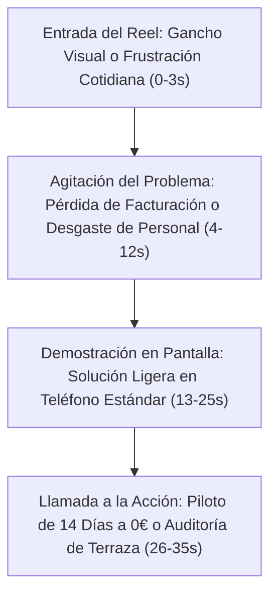

# Análisis Forense de 22 Reels Virales (HORECA SaaS B2B) y Estrategia de Contenidos para Fluxo

> **Fecha:** Octubre 2026  
> **Departamento:** Marketing & Ventas — Fluxo  
> **Ámbito de Aplicación:** Adquisición de Cliente Cero y Redes Sociales (Instagram / TikTok / LinkedIn)  
> **Área Geográfica Inicial:** Noia, Barbanza y Santiago de Compostela  

---

## 1. Resumen Ejecutivo y Mapeo Temático de los 22 Enlaces

Tras el análisis de los 22 reels de referencia del sector HORECA B2B (agrupados en cuentas como `@coffeefy.app`, `@tapstars.ok`, `@lacarta.app`, `@forkpi`, `@menuly.ar`, `@ordermanager_es`, `@flypaxapp`, `@leadinbusinessmarketing` y `@heydiga`), se constata un patrón común: **la venta en redes a hosteleros no funciona mediante demostraciones técnicas de software, sino a través de la visibilización de la fricción física, la fatiga del personal y la pérdida silenciosa de facturación en sala.**

Los 22 impactos se desglosan en **5 Arquetipos de Contenido Viral**:

1. **El Club de Fidelización y la Comparativa Local (Sellos Digitales y Reseñas en Google Maps)**
   - *Referencia:* `@coffeefy.app` (`DeZblV9uAt4`), `@tapstars.ok` (`DealaFex5kB`, `DeVBCJDSVKI`, `Dd_z0Jut58a`).
   - *Tesis:* Dos locales en la misma calle con idéntico producto y precio; uno lleno y otro vacío. La diferencia radica en un mecanismo que premia visitas repetidas sin tarjetas físicas y deriva reseñas positivas a Google Maps de forma inmediata.
2. **El "Fundador en las Trincheras" (Cámara en Mano y Resolución de Fricciones Reales)**
   - *Referencia:* `@lacarta.app` (`DeYR4__TVQD`, `DeSJ7yCPr4j`, `DePjvHAsDhC`), `@forkpi` (`DavijstIk8d`, `DcWTEFKCkNy`).
   - *Tesis:* El creador entra a locales reales, muestra los errores habituales (cartas en PDF de 40 MB con zoom imposible, tachaduras con bolígrafo, camareros corriendo desbordados en terraza) y enseña la solución operando en un móvil corriente en menos de 10 segundos.
3. **El Camarero Atleta y la Fatiga de Terraza (Kilómetros Inútiles)**
   - *Referencia:* `@ordermanager_es` (`Ddewmw8PGtf`, `DbSOKBTR2Ym`, `DcTLsNckWcT`), `@flypaxapp` (`Dba9g0boanQ`, `DdAaCvQNcqd`).
   - *Tesis:* Se cuantifica el desgaste físico del camarero (12 a 16 km por turno) por el "paseo de tres viajes" (ir a tomar nota, ir a comandar al TPV, volver con la cuenta). La solución BYOD reduce 4 km de caminatas vacías por turno y libera 10 minutos por rotación de mesa.
4. **La Carta Inteligente que Vende Sola (Sugerencias Automáticas y Menú Actualizado)**
   - *Referencia:* `@menuly.ar` (`DdAIGjhij19`, `DcgiaOmOTyC`, `Db5G6tlRxVR`), `@forkpi` (`DZfjnRPuMhY`).
   - *Tesis:* Las fotos reales de alta definición y las sugerencias visuales aumentan el ticket medio entre un 14% y un 22% frente a la lista de texto estática en papel o PDF ilegible.
5. **La Automatización de Respuestas y Agente de Reservas / Consulta**
   - *Referencia:* `@heydiga` (`DeNsIDMpHyl`, `DcUeOPOjBDH`, `Dd9GQlBymOb`), `@leadinbusinessmarketing` (`DeaSK7EyGjS`).
   - *Tesis:* Pérdida de reservas en fines de semana porque nadie atiende el teléfono durante las horas de mayor actividad. El agente digital atiende dudas por WhatsApp sin colapsar al personal.

---

## 2. Anatomía de los 5 Arquetipos Virales y Adaptación a Fluxo

### Arquetipo 1: "Dos Cafeterías en la Misma Calle" (Fidelización y Reseñas Google)
- **Gancho (Hook 0-3s):** *"Mismo café, mismo precio, misma calle. Uno tiene cola en la puerta y el otro está medio vacío. ¿Por qué?"*
- **Desarrollo (4-15s):** Enseña el problema: el cliente habitual se marcha sin dejar rastro y sin dejar reseña en Google. Con una tarjeta de cartón, el 80% la pierde o la olvida en casa.
- **Solución Fluxo (16-25s):** Enseña el flujo del cliente: introduce su email al pedir o pagar, acumula puntos aprobados por el camarero en la misma comanda y, tras la experiencia positiva, el sistema le sugiere dejar 5 estrellas en Google Maps con un solo toque.
- **CTA (26-30s):** *"Si tienes un local en Santiago o comarca y quieres llenar tu terraza con clientes recurrentes, te instalamos el piloto de 14 días a coste cero."*

### Arquetipo 2: "El Camarero que Hace Maratones en Terraza" (Operativa de Sala)
- **Gancho (Hook 0-3s):** *"Tu camarero de terraza camina entre 12 y 15 kilómetros por turno. Y la mitad son paseos completamente inútiles."*
- **Desarrollo (4-15s):** Desglose del "viaje triple": Paseo 1 (llevar la carta y esperar que decidan). Paseo 2 (ir a la barra a cantar la comanda o teclearla en el TPV fijo). Paseo 3 (ir a cobrar con el datáfono).
- **Solución Fluxo (16-25s):** El comensal pide desde la mesa o el camarero anota desde su propio móvil (BYOD). La cocina recibe los platos organizados por tiempos al segundo. El personal solo camina para servir comida y atender con calma.
- **CTA (26-30s):** *"Ahorra 10 minutos por mesa y rota más clientes este fin de semana. Enlace en el perfil para probarlo 14 días sin permanencia."*

### Arquetipo 3: "La Tortura del Menú en PDF" (Experiencia del Cliente)
- **Gancho (Hook 0-3s):** (Primer plano ampliando desesperadamente un PDF borroso con los dedos) *"Si tus clientes tienen que hacer esto para ver tus platos, estás perdiendo dinero."*
- **Desarrollo (4-15s):** Muestra los fallos habituales: descarga de un archivo de 20 megas con mala cobertura en terraza, letras diminutas, platos agotados que siguen figurando y precios tachados a mano en la versión física.
- **Solución Fluxo (16-25s):** Apertura instantánea por navegador web, platos con fotografía limpia, información clara sobre alérgenos según normativa y posibilidad de desactivar platos agotados en dos clics desde el teléfono del encargado.
- **CTA (26-30s):** *"Digitalizamos tu carta completa en 24 horas y te dejamos probar el sistema en sala sin coste alguno."*

### Arquetipo 4: "La Comanda que se Perdió en Cocina" (Cero Pérdidas de Tickets)
- **Gancho (Hook 0-3s):** *"El clásico papelito de comanda que se mancha de grasa, se cae al suelo o nadie entiende la letra."*
- **Desarrollo (4-15s):** Muestra el estrés en cocina durante la hora punta de un sábado: discusiones entre sala y cocina por qué mesa pidió antes o platos que salen tarde.
- **Solución Fluxo (16-25s):** Pantalla de cocina (KDS) en cualquier tablet o pantalla económica que ya tenga el local. Filtro previo del camarero (*Mozo Gatekeeper*) para validar antes del envío a cocina. Tiempos cronometrados y organización por partidas.
- **CTA (26-30s):** *"Cero hardware propietario. Funciona en las pantallas que ya tienes en el local. Agenda una prueba piloto de 14 días."*

### Arquetipo 5: "El TPV Pesado de 2.000€ vs La Alternativa Ligera" (Anti-Hardware y Coste)
- **Gancho (Hook 0-3s):** *"Te cobran 1.500€ por una pantalla fija, 300€ por cada comandera y un mantenimiento mensual abusivo."*
- **Desarrollo (4-15s):** Las empresas de TPV tradicionales obligan a adquirir equipamiento rígido que queda obsoleto y ata al hostelero a contratos de permanencia prolongados.
- **Solución Fluxo (16-25s):** Fluxo opera en la nube y en cualquier móvil o tablet del personal. Sin permanencia, sin comisiones por pedido y sin tocar el sistema de caja o datáfono que el local ya utiliza.
- **CTA (26-30s):** *"Planes claros desde 39€/mes para carta digital o 69€/mes para sala completa. Descubre cómo empezar sin ataduras."*

---

## 3. Plan de Acción de Contenidos para el Fundador en Galicia

1. **Grabación de Contenido Real en Locales Piloto (Estilo Fundador Cercano):**
   - Utilizar un teléfono móvil convencional con micrófono de solapa inalámbrico.
   - Grabar en terrazas y barras reales de Noia, Ribeira, Boiro o Santiago de Compostela durante la preparación previa (hora valle).
   - Enfoque directo y natural: hablar en primera persona como desarrollador gallego que ayuda a los bares de la zona a optimizar el servicio.

2. **Estructura de Distribución Semanal:**
   - **Lunes:** Caso de estudio u optimización de carta (Arquetipo 3).
   - **Miércoles:** Fricción de sala y rendimiento de camareros en terraza (Arquetipo 2).
   - **Viernes:** Preparación para el fin de semana: fidelización, reseñas en Google y rotación rápida (Arquetipo 1 o 4).

3. **Conversión y Captación de Leads:**
   - La llamada a la acción en todos los vídeos dirige al WhatsApp directo o a la página web para solicitar el **Acuerdo Piloto de 14 Días a 0€**.
   - Oferta de digitalización de carta sin coste inicial por parte del equipo de Fluxo para eliminar toda barrera de entrada.
