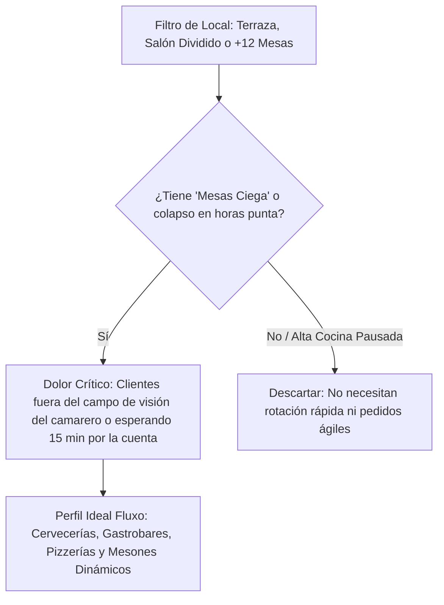

# MANUAL DE ENTRENAMIENTO COMERCIAL: NEUROVENTAS & CIERRE HOSTELERO

> **Área:** Marketing & Ventas — Fluxo  
> **Objetivo:** Guía práctica para el fundador y comerciales a pie de calle en Galicia (Noia, Barbanza, Santiago) y conversaciones de WhatsApp.  
> **Filosofía Base:** Vender el alivio operativo y el beneficio económico neto, jamás la tecnología.

---

## 1. El Nicho Quirúrgico y las "Mesas Ciega" (Punto 1 y 3)

### ¿Para qué dueño es exactamente Fluxo?
No todos los locales son clientes de Fluxo. Intentar venderle a cualquiera genera objeciones infinitas. Nos anichamos en locales con volumen, terraza o salones con puntos ciegos:

* **El Factor "Mesa Ciega" (El argumento definitivo de venta):**
  * ¿Cuenta si el local tiene mesas adentro y afuera? **Sí, totalmente.**
  * Más aún: locales con **altillos, recovecos, comedores en forma de 'L' o terrazas detrás de columnas o toldos** donde el personal desde la barra o cocina *no ve al cliente*.
  * En esas mesas el comensal se desespera con la mano levantada. Con Fluxo, pulsa "Llamar al camarero" o "Pedir cuenta" y al personal le vibra el aviso con el número de mesa exacto sin tener que estar vigilando constantemente.
* **El Local Ideal ("Carlos"):**
  * 15 a 30 mesas entre salón y terraza.
  * Viernes y sábados con rotación continua.
  * Dueño o encargado corriendo en sala para apagar fuegos.
* **El Local que NO queremos:**
  * Restaurante gastronómico de menú degustación de 3 horas.
  * Bar diminuto de 4 mesas alineadas a 1 metro de la barra.

---

## 2. Reestructuración de la Fidelización: Sellos vs Puntos y Recompensas (Punto 2)

### ¿Qué producto se regala al llegar a las 8 consumiciones?
Para que el hostelero no sienta que "pierde dinero" y el comensal sienta un beneficio real, la recompensa debe seguir la regla de **Alto Valor Percibido / Bajo Coste de Materia Prima**:

1. **Cafeterías / Desayunos (6 u 8 sellos):**
   * *Recompensa:* El 7º u 8º café gratis, o una porción de bizcocho/croissant artesanal.
   * *Coste real hostelero:* Apenas 0,15€ - 0,30€.
   * *Valor percibido comensal:* 1,50€ - 2,20€.
2. **Cervecerías / Gastrobares (8 consumiciones):**
   * *Recompensa:* Caña de cerveza de la casa, pinta artesanal, o ración de patatas / tapa especial de la casa.
   * *Coste real hostelero:* Menos de 0,60€.
   * *Valor percibido:* 3,00€ - 4,50€.
3. **Pizzerías / Restaurantes (8 visitas o platos principales):**
   * *Recompensa:* Postre casero gratis o entrante para compartir en la siguiente visita.
   * *Coste real:* Menos de 0,90€.
   * *Valor percibido:* 5,00€ - 6,50€.

> **Regla de Oro:** La recompensa nunca debe canjearse en la misma comida del 8º sello si es una ración; se invita en la *próxima visita* o se entrega al instante en café/postre, asegurando la recurrencia.

---

## 3. Protocolo de Apertura: Los Primeros 60 Segundos (Puntos 3, 5, 10 y 19)

### Guion de Apertura Presencial (Marco de Control)
Entra en hora valle (11:00-12:00 o 17:00-18:00). Postura erguida, tono pausado:

> *"Hola [Nombre], qué tal. Vengo rápido porque sé que estáis en plena preparación previa. Te hago una pregunta directa sobre la terraza y las mesas de atrás donde no llega la vista: los viernes por la noche con el local hasta arriba, ¿cuántos viajes hacen tus camareros a las mesas solo para llevar la cuenta con el datáfono y volver?"*

Si responde que es un caos o que siempre se acumula gente esperando:
> *"Exacto. Pierdes entre 10 y 12 minutos por mesa solo esperando a cobrar. Si te parece, te hago dos preguntas rápidas para ver cómo tenéis organizada la sala y, si encaja, vemos cómo organizar el servicio para que ganéis más dinero por rotación rápida sin depender de que el camarero tenga que estar encima de cada mesa al segundo."*

---

## 4. El Cambio Psicológico en el Cierre: Cero "Gracias" y Frases Prohibidas (Puntos 17 y 18)

| ❌ Frase Prohibida / Sumisa | ✅ Frase de Autoridad y Certeza | Por qué funciona |
| :--- | :--- | :--- |
| *"Muchísimas gracias por tu tiempo / por atenderme"* | *"Me alegro de que hayamos coordinado esto, [Nombre]. Es una decisión muy inteligente para organizar tu negocio, ganar más dinero en terraza y que tus camareros no terminen el turno desbordados."* | Te sitúa como un socio estratégico de rentabilidad, no como un vendedor pidiendo un favor. |
| *"Creo que esto te podría servir..."* | *"Esto te va a ahorrar 4 kilómetros por turno y va a liberar las mesas 10 minutos antes."* | Proyecta certeza total en el impacto económico. |
| *"Cuando tengas un hueco avísame y lo miramos."* | *"Lo dejamos activo hoy en 15 minutos en 5 mesas de terraza y el lunes medimos cuántas mesas rotaron."* | Compromiso inmediato de acción. |
| *"¿Te parece bien si probamos a ver qué pasa?"* | *"Probémoslo durante 2 fines de semana completos a coste cero. Si no te convence, lo quitamos y no has gastado ni un euro."* | Elimina cualquier barrera de riesgo. |

---

## 5. El Desafío de los 14 Días: El Filtro de los 2 Fines de Semana (Punto 4)

El período de 14 días permite evaluar la operativa sin excusas coyunturales (lluvia, festivos, etc.):
1. **Fin de Semana 1:** Adaptación del equipo, puesta a prueba de pedidos de cuenta y llamadas sin contacto visual.
2. **Días Laborables Intermedios:** Ajustes en cocina y configuración de carta.
3. **Fin de Semana 2:** Prueba a pleno rendimiento con el personal rodado.
4. **Día 14 (Cierre):** Se entrega el informe de impacto. Al haber ganado agilidad y dinero durante 2 fines de semana seguidos, el dueño no quiere retirar el sistema.

---

## 6. Soportes Físicos de Mesa: Presupuesto y Materiales (Punto 5)

Para una implementación real en sala o una prueba piloto inicial:

* **Kit Mínimo Piloto (4 a 5 QRs para zona crítica o 'mesa ciega'):**
  * Para probar el sistema en un local piloto no hace falta equipar todo el restaurante el primer día.
  * Basta con **4 o 5 soportes** colocados estratégicamente en las mesas más lejanas o en la terraza.
  * **Inversión Mínima Piloto:** Apenas **6,40 € a 8,00 €** en materiales para arrancar la prueba de 14 días.

| Modalidad | Cantidad de Mesas | Coste Unitario | Inversión Total |
| :--- | :--- | :--- | :--- |
| **Kit Piloto Zona Crítica** | **4 - 5 Mesas** | ~1,60 € | **~6,40 € - 8,00 €** |
| **Local Mediano (Terraza)** | 15 Mesas | ~1,60 € | ~24,00 € |
| **Local Completo (Sala + Terraza)** | 25 Mesas | ~1,60 € | ~40,00 € |

> Con menos de **8€ de inversión en materiales**, se deja instalado un piloto funcional de 4-5 mesas en la zona más problemática del restaurante. Una vez comprobada la eficacia tras el segundo fin de semana, se fabrica el resto del lote para todo el local.

---

## 7. Estrategia Audiovisual con IA (Higgsfield / Estilo Ramiro Cubría) (Punto 6)

### Plan de Producción Financiado con el Primer Cliente
* El coste de Higgsfield (~40€ - 50€/mes) se autofinancia directamente con la captación del **primer cliente de pago** (Plan Sala 69€ o Plan Full 99€).
* **Estructura del Video Viral de Alto Impacto:**
  1. *Gancho (0-3s):* Primer plano del comensal levantando la mano en una mesa de terraza apartada, mirando al vacío durante minutos.
  2. *Tensión (4-10s):* El camarero desbordado en la barra con 4 comandas en la mano mientras dos mesas esperan el datáfono para marcharse.
  3. *Solución Fluxo (11-20s):* Tocar la pantalla del móvil, aviso inmediato en el bolsillo del camarero, cobro en una sola pasada y mesa liberada al instante.
  4. *Cierre (21-30s):* *"Organiza tu sala. Libera tus mesas 12 minutos antes. Prueba Fluxo 14 días sin permanencia."*
