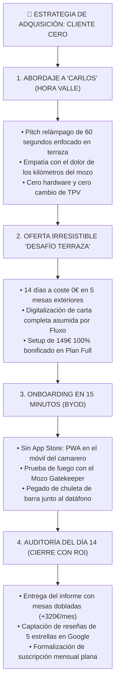

# 🚀 PLAN DE ADQUISICIÓN: CLIENTE CERO (FLUXO GASTRONOMIC SYSTEM)
> **Departamento:** Marketing & Growth B2B  
> **Fecha:** 2026-10-13  
> **Objetivo:** Adquisición del primer local piloto real en Galicia (Noia, Barbanza o Santiago).

---



---

## 1. Pitch de Venta Directa (Script de 60 Segundos)

### 🎙️ Modalidad Presencial (Cara a Cara en Hora Valle: 11:00-12:15 o 17:00-18:30)
> *"Hola Carlos, buenas tardes. Sé que estás montando el servicio y no te robo ni un minuto.  
> 
> No vengo a venderte ningún software caro ni a pedirte que cambies tu TPV. Solo una pregunta: un viernes por la noche con la terraza hasta arriba, ¿cuántos kilómetros caminan tus camareros solo para ir a una mesa a preguntar '¿qué deseaban?' y volver a por el datáfono para cobrarles?  
> 
> Desarrollamos **Fluxo** justo para eso: el cliente pulsa un botón en su móvil para pedir la cuenta con tarjeta, a tu camarero le vibra el teléfono y sale **una sola vez directo con el datáfono**. Le ahorras el 50% de los viajes a tu equipo, la mesa se desocupa 10 minutos antes y, al pagar, el cliente te deja una reseña de 5 estrellas en Google Maps.  
> 
> Funciona en los mismos teléfonos que ya tenéis en el bolsillo, sin comprar pantallas de 1.000€.  
> 
> Te propongo el **Desafío Terraza**: este viernes te digitalizamos la carta gratis y lo probamos en 5 mesas. Si el lunes tus camareros no te dicen que trabajaron con la mitad de agobio, me llevo los códigos y te costó cero euros. ¿En qué 5 mesas sufren más tus mozos?"*

### 📱 Modalidad WhatsApp (Seguimiento o Contacto Previo)
```text
Hola Carlos, buenas tardes. Te escribo rápido porque sé cómo se ponen las terrazas aquí los fines de semana.

Creamos una herramienta ligera llamada Fluxo que se usa desde el propio móvil de los camareros (sin comprar aparatos ni tocar tu TPV de siempre). 

Hace dos cosas clave:
1. El cliente pide la cuenta con tarjeta desde el QR y el camarero va directo con el datáfono en mano (se ahorra la mitad de los paseos).
2. Tras pagar, el sistema le sugiere dejar una reseña de 5 estrellas en tu Google Maps.

Queremos activar a 3 locales de referencia en la zona con el Desafío Terraza de 14 días: te digitalizamos la carta hoy mismo sin coste y lo pruebas en 5 mesas este fin de semana a 0€.

¿Te paso un vídeo de 20 segundos de cómo lo ve el camarero?
```

---

## 2. Propuesta de Valor y Copywriting (Landing Page / One-Pager)

### 🟢 HERO SECTION
* **Titular Principal:**  
  *Menos pasos basura para tus camareros. Más mesas dobladas en terraza.*
* **Subtítulo:**  
  *La alternativa web a los TPVs pesados. Sincroniza mesas, camareros y cocina en tiempo real sin comprar pantallas industriales ni pagar comisiones por venta.*
* **Botón Principal (CTA):**  
  `[ Solicitar Desafío Terraza de 14 Días (0€) ]`
* **Prueba Social / Garantía:**  
  *Cero cambio de TPV • 100% en los móviles de tu equipo (BYOD) • 0% de comisiones por ticket.*

---

### 🔴 PROBLEMA VS. SOLUCIÓN

| El Dolor de Sala en Terrazas | La Solución con Fluxo Gastro |
| :--- | :--- |
| **Camareros maratonistas:** Hacen 2 o 3 viajes por mesa (ir a preguntar, volver a la barra, regresar a cobrar). | **Llamador con Intención:** El cliente solicita "Cuenta con Tarjeta" o "Agua". El mozo acude en 1 solo viaje directo. |
| **Pánico a los pedidos de broma por QR:** Miedo a que alguien pida desde la calle y cocina prepare platos falsos. | **Mozo Gatekeeper Antifraude:** La comanda queda en espera (`pending_validation`). Cocina no cocina nada hasta que el camarero aprueba. |
| **Comisiones abusivas del 2%:** Plataformas de pago móvil que se quedan con un porcentaje de cada cuenta. | **0% de comisiones:** Tarifa plana mensual (69€ o 99€). Sigues cobrando con tus datáfonos de siempre. |
| **Hardware frágil y caro:** Pantallas de 1.000€ que si fallan un sábado paralizan la cocina. | **100% Web (BYOD):** Si una tablet se rompe, cualquier móvil del local asume el control en 10 segundos. |

---

### ⭐ DIFERENCIADORES FRENTE AL TPV TRADICIONAL

1. **"No toques tu TPV":** No migras contabilidad, no cambias de banco, no reentrenas a toda la plantilla. Fluxo se monta como una capa de aceleración exterior.
2. **Multiplicador de Reputación Nativo:** Al terminar la comanda o pedir la cuenta, el sistema guía al cliente satisfecho a dejar una reseña de 5 estrellas en tu Google Maps.
3. **Modularidad Quirúrgica:** Activa solo lo que necesitas:
   * ¿Solo carta digital interactiva? -> **Plan Carta (39€/mes)**
   * ¿Comandero de camarero + llamador en terraza? -> **Plan Sala (69€/mes)**
   * ¿Circuito completo con KDS de cocina e impresión ESC/POS? -> **Plan Full (99€/mes)**

---

## 3. Plan de Oferta de Lanzamiento: El "Cliente Cero"

* **Nombre de la Oferta:** *El Desafío Terraza de 14 Días a Coste Cero*.
* **Términos Transparentes:**
  1. **Duración:** 14 días naturales en 5 a 10 mesas clave de terraza.
  2. **Coste del Piloto:** 0,00 € (Sin tarjeta de crédito, sin fianza).
  3. **Digitalización VIP por el Fundador:** Subida completa de platos, descripciones vendedoras, fotografías y mapeo normativo de los 14 alérgenos de la UE en <24h.
  4. **Entrega de Material Físico:** Hasta 10 peanas QR de alta resistencia para exterior en depósito gratuito.
  5. **Cláusula de Salida Sin Fricción:** Si al día 14 el hostelero no está satisfecho, retiramos las peanas sin preguntas ni penalizaciones.
  6. **Palanca de Cierre:** Al consolidar el servicio, el **Setup oficial de 149€ queda 100% BONIFICADO (0€)** en el Plan Full (99€/mes) o Plan Sala (69€/mes).

---

## 4. Matriz de Objeciones y Respuestas de Alto Impacto

### ❓ Objeción 1: *"¿Qué pasa si se cae el Wi-Fi o internet en la terraza?"*
* **Por qué lo dice:** Miedo al colapso en hora punta y a clientes enfadados.
* **Respuesta Táctica del Comercial:**
  > *"Es el miedo más común, Carlos, y lo resolvimos desde el diseño. Primero, la carta de Fluxo es una PWA ultraligera: una vez que el cliente la abre, se guarda en la memoria del teléfono y sigue visible aunque falle la cobertura. Segundo, si el Wi-Fi del bar se apaga, tus camareros usan los datos móviles 4G/5G que ya tienen en sus teléfonos sin notar la diferencia. Y tercero: tu TPV y tus datáfonos de siempre siguen funcionando en la barra exactamente igual que hoy. No dependes de un servidor local que pueda quemarse."*

---

### ❓ Objeción 2: *"¿Mis camareros sabrán usarlo o se van a liar con otra pantalla?"*
* **Por qué lo dice:** Resistencia al cambio del personal veterano y miedo a ralentizar el servicio.
* **Respuesta Táctica del Comercial:**
  > *"Si tus camareros saben enviar un WhatsApp, saben usar Fluxo en 2 minutos. No hay menús complicados: la pantalla del mozo solo tiene dos colores: Amarillo cuando una mesa pide confirmar comanda, y Azul cuando piden la cuenta con datáfono. Pulsan un botón verde gigante y listo. De hecho, los primeros que te van a pedir que dejemos el sistema son tus propios camareros, porque van a dejar de caminar 6 kilómetros de viajes dobles cada sábado."*

---

### ❓ Objeción 3: *"¿Por qué no sigo con el papel y la comanda de toda la vida?"*
* **Por qué lo dice:** Inercia operativa y desconfianza en la tecnología.
* **Respuesta Táctica del Comercial:**
  > *"El papel funciona hasta que la terraza se llena. Con papel, tu camarero tiene que hacer tres viajes: ir a la mesa a ver qué quieren, ir a la barra a cantar el pedido, y al final volver dos veces más a por la cuenta y el datáfono. En ese tiempo, una mesa tarda 15 minutos solo en marcharse después del café. Con Fluxo la mesa pide la cuenta, el mozo sale directo con el datáfono y liberas la mesa en 2 minutos. Si doblas una sola mesa extra al día gracias a esa rapidez, son 30€ más en la caja cada turno. El papel no te consigue reseñas de 5 estrellas en Google ni te ahorra horas de camareros."*
