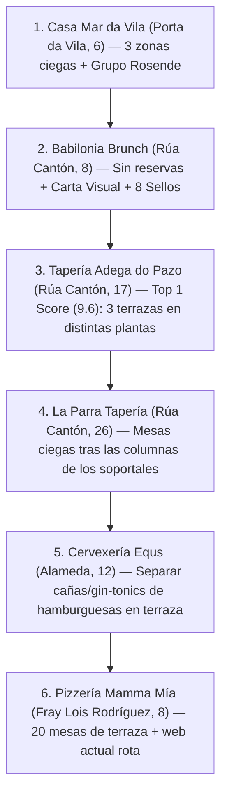

# 🎯 BASE DE DATOS MAESTRA CRM Y PROSPECCIÓN COMERCIAL — NOIA (35 LOCALES ACTIVOS)

> **Departamento:** Marketing & Ventas — Fluxo  
> **Ámbito:** Municipio de Noia (Casco Histórico, Cantón, Curro, Alameda y Malecón)  
> **Objetivo:** Captación de los primeros 3 locales piloto con el *Desafío de 14 Días a 0€* (Kit Mínimo de 4-5 QRs en zonas críticas).  
> **Precios Canónicos:** Plan Carta (39€/mes) | Plan Sala (69€/mes) | Plan Full (99€/mes) | Plan Suite (139€/mes) | Setup (149€ bonificado al 100% en piloto).  
> **Última Actualización:** 17 de Octubre de 2026  

---

## 🧠 1. Radiografía del Mercado de Noia y Segmentación por Arquetipos (ICP)

El censo auditado en Noia abarca **40 establecimientos** (35 objetivos activos + 5 descartes técnicos). El **85% de las reseñas negativas (1★ a 3★)** en Noia NO critican la comida, sino **fallos de coordinación entre sala, barra y cocina en horas punta** (demoras de 20 min entre tapas, platos agotados no avisados, guarniciones que se enfrían o esperas largas para pagar en terraza).

### Los 3 Segmentos de Ataque en Noia:
1. **`[ICP-CARLOS]` — Terrazas y Alto Volumen (13 Locales):**
   * *Perfil:* Cervecerías, pizzerías, hamburgueserías y gastrobares con 12 a 25 mesas y "mesas ciegas" (varias terrazas, soportales o plantas).
   * *Propuesta:* **Plan Sala (69€) o Plan Full (99€)** (Carta QR + Llamador/Pedir Cuenta con Datáfono + Comandero Mozo + KDS Cocina/Barra + Embudo Google 5★).
2. **`[ICP-MARTIN]` — Mesones, Taperías y Marisquerías Tradicionales (13 Locales):**
   * *Perfil:* El trato verbal del camarero es sagrado, pero sufren colapsos en cocina, roturas de stock sin avisar y turistas que no entienden la carta.
   * *Propuesta:* **Plan Sala (69€)** activando solo el flujo **Comandero Mozo $\rightarrow$ KDS Cocina** (sin obligar al cliente a pedir por QR si el dueño prefiere trato clásico) + **Carta en 10 idiomas** + **Control de platos agotados en 1 toque**.
3. **`[ICP-LUCIA]` — Cafeterías, Brunch y Menú Diario (9 Locales):**
   * *Perfil:* Locales de desayuno/merienda, *brunch* sin reservas o menú del día cambiante.
   * *Propuesta:* **Plan Carta (39€) o Plan Sala (69€)** + **Fidelización por 8 Sellos Digitales** + **Botón de pedir cuenta rápida**.

---

## ⚠️ 2. Correcciones Críticas de Campo al Informe DeepResearch (Evitar Errores en Calle)

1. **Prohibido citar "RestoBar Noia en Rúa do Curro" como caso real vecino:**
   * En un pueblo como Noia todos los hosteleros de la Rúa do Curro se conocen por su nombre. Si dices que *"RestoBar Noia en la Rúa do Curro ganó +2.501€/mes con nosotros"*, sabrán al instante que ese bar no existe y perderás toda credibilidad.
   * **Cómo usarlo:** Preséntalo siempre como una **Simulación / Proyección Financiera Estándar para un local de 15-20 mesas en Noia**.
2. **Oportunidad de Grupo 2x1 (*Hostelería Rosende*):**
   * Al cruzar nuestra investigación previa con el informe, detectamos que **Casa Mar da Vila** (Porta da Vila, 6) y **Don Juan Gastrofusión** (Alameda / Xenaro Carrero, 25) pertenecen al mismo grupo empresarial (**Hostelería Rosende**). Entrar en uno abre la puerta directa al segundo.
3. **Actualización Forense de *Casa Mar da Vila* y *Babilonia Brunch*:**
   * *Casa Mar da Vila* no es solo `[ICP-LUCIA]`: tiene **3 zonas ciegas** (terraza exterior, acristalada y jardín) y hoy usa el visor pasivo de *Ágora POS* (`smartmenu.agorapos.com`). Es objetivo de **Plan Sala (69€) / Full (99€)**.
   * *Babilonia Brunch* (`@babilonia.brunch`, Rúa Cantón 8) no es un bar tradicional de Tier 3: tiene +2.500 seguidores, 4,4★ en Google, **no admite reservas** (se forman colas) y es ideal para **Carta Visual + Pedir Cuenta Rápida + 8 Sellos Digitales**.

---

## 📊 3. Tabla Maestra CRM de Prospección en Noia (35 Locales Ordenados por Prioridad)

### 🔥 TIER 1 — Prioridad Máxima (13 Locales + 2 Ascensos Directos)

| # | Score | Local | Dirección / Zona | ICP | Tipo y Distribución Física | Google Maps | Estado Digital Actual | Dolor Detectado en Reseñas / Operativa | Plan Fluxo Objetivo | Gancho Exacto de Entrada (Hora Valle) |
| :-: | :-: | :--- | :--- | :-: | :--- | :---: | :--- | :--- | :--- | :--- |
| **1** | **9.6** | **Tapería Adega do Pazo** | Casco Histórico / Rúa do Cantón, 17 | `CARLOS` | Cervecería, tapería y coctelería en piedra con **3 terrazas (2 interiores + 1 exterior, ~25 mesas)** en varias plantas. | 4.3 ★ (+1.220) | Web estática (`taperiaadegadopazo.es`) sin QR interactivo. | Desconexión física extrema entre cocina, barra de cócteles y sus 3 terrazas en distintas plantas ("mesas ciegas"). | **Plan Full (99€)** | *"Con 3 terrazas en distintas plantas, ¿cuántos viajes en vacío hacen tus camareros solo para ver si una mesa quiere otra ronda o pagar con tarjeta?"* |
| **2** | **9.4** | **Pizzería Mamma Mía / MammaMia Burger** | Centro / Rúa Fray Lois Rodríguez, 8-9 | `CARLOS` | Pizzería, burger y cafetería con **terraza exterior (20 mesas, 70 pax)** y menú diario. | 4.3 ★ (+100) | Web WordPress rota (`?menu=sin-categorizar`), papel en sala. | Colapso en horas pico cuando chocan las 20 mesas de terraza con los pedidos para llevar y modificadores de burgers/pizzas. | **Plan Full (99€)** | *"Vimos que el menú de vuestra web sale desconfigurado. ¿Qué tal si probamos 4-5 QRs en terraza para que las pizzas y burgers entren limpias y sin errores?"* |
| **3** | **9.2** | **Restaurante El Txoko** | Casco Histórico / Rúa da Condesa, 2 | `MARTIN` | Tapas, vinos y raciones (cachopo, pulpo, carnes) con terraza muy demandada. | 4.3 ★ (462) | Carta en papel + fotos en IG. Sin KDS en cocina. | Reseñas de 1★ por **platos agotados no avisados (cachopo)** y esperas de **20 min entre tapa y tapa**. | **Plan Sala (69€) / Full (99€)** | *"¿Cuántas veces va el camarero a cocina solo para descubrir que se acabó el cachopo? Con esto bloqueas agotados en 1 toque y coordina el pase."* |
| **4** | **9.0** | **Arrocería Baobab** | Alameda / Rúa Pintor Xenaro Carrero, 15 | `MARTIN` | Arroces melosos, brasas, pescados y tex-mex con salón amplio y terraza. | 4.6 ★ (669) | Solo Instagram (`@arroceriabaobabnoia`), papel en sala. | Complejidad para coordinar tiempos entre entrantes rápidos, arroces de larga cocción y carta extensa de vinos. | **Plan Sala (69€) / Full (99€)** | *"Para que las bebidas y vinos vayan directo a barra sin ensuciar los tickets de arroces en cocina, y retener postres hasta que terminen."* |
| **5** | **8.9** | **Forno do Rato** | Centro / Rúa Oviedo Arce, 24 | `CARLOS` | Parrillada y restaurante de gran volumen con comedor y **gran terraza cubierta**. | 4.1 ★ (1.096) / 3.2★ TA | 100% papel; sin web ni carta digital. | Congestión en la terraza cubierta en picos de churrasco y nota penalizada en Google (4.1★) y TripAdvisor (3.2★). | **Plan Full (99€)** | *"En la terraza cubierta en pleno domingo de churrasco, ahorras la mitad de paseos al pedir la cuenta y subes ese 4,1★ en Google en un mes."* |
| **6** | **8.8** | **Cervexería Equs** | Alameda / Rúa da Alameda, 12 | `CARLOS` | Cervecería, cafetería y gin-club con **terraza en la Alameda (~18 mesas)**. | 4.0 ★ (589) | Solo Facebook; carta extensa en papel. | Caos al mezclar desayunos, cenas de hamburguesas/tablas y copas nocturnas sin separar barra de cocina. | **Plan Full (99€)** | *"Separamos las cañas y gin-tonics en barra de las hamburguesas en cocina, y facilitamos pedir la segunda ronda desde la terraza de la Alameda."* |
| **7** | **8.7** | **A Taberna de Lelo** | Casco Histórico / Costa do Ferrador, 19 | `MARTIN` | Taberna de tapas, mariscos y pulpo con mesas exteriores en zona turística. | 4.5 ★ (+100) | Solo Instagram (`@a.taberna.de.lelo`), carta en papel. | Múltiples viajes del camarero a cocina y barrera de idioma con peregrinos/turistas extranjeros. | **Plan Sala (69€)** | *"Ahorras decenas de viajes a cocina en Costa do Ferrador y tienes toda tu carta de mariscos y pulpo traducida a 10 idiomas al instante."* |
| **8** | **8.6** | **La Parra Tapería** | Casco Histórico / Rúa do Cantón, 26 | `CARLOS` | Tapería con **terraza bajo los soportales de piedra** (raciones, cachopo, vegano). | 4.5 ★ RG / 3.7★ TA | Sin web; carta en papel. | **"Mesas ciegas"**: las columnas de piedra de los soportales tapan la visión del camarero hacia las mesas. | **Plan Sala (69€) / Full (99€)** | *"Detrás de las columnas de los soportales no se ve quién levanta la mano para pedir pan, otra caña o la cuenta con datáfono. Probemos 4 QRs ahí."* |
| **9** | **8.5** | **Pizzería Venecia** | Centro / Rúa Francisco Romero Blanco, 2 | `CARLOS` | Pizzería italiana, tapería y menú del día. | 4.0 ★ (+100) | Web estática (`pizzeriavenecianoia.com`) y directorios pasivos. | Nota estancada en 4.0★ y fricción al cambiar entre menú del día al mediodía y pizzería por la noche. | **Plan Full (99€)** | *"Actualizas el menú del día en dos toques, metes las pizzas a cocina sin errores y subimos ese 4,0★ en Google Maps con reseñas post-cobro."* |
| **10** | **8.5** | **Casa Mar da Vila** *(Ascenso a Tier 1)* | Casco Histórico / Porta da Vila, 6 | `CARLOS` | Hotel boutique + cafetería + restaurante (*Grupo Hostelería Rosende*) con **terraza calle + acristalada + jardín**. | 4.1 ★ | Web con visor pasivo *Ágora POS* (`smartmenu.agorapos.com`) y reserva `mailto:`. | **"Mesas ciegas" en 3 zonas** (calle, acristalada y jardín); quejas de lentitud en horas punta. | **Plan Sala (69€) / Full (99€)** | *"Vuestro visor actual solo deja leer la carta, pero si alguien en el jardín o terraza acristalada quiere pagar con tarjeta, el camarero da viajes en vacío."* |
| **11** | **8.4** | **Don Juan Gastrofusión** | Alameda / Rúa Pintor Xenaro Carrero, 25 | `CARLOS` | Gastrobar amplio (*Grupo Hostelería Rosende*: desayunos, menú del día, raciones). | 5.0 ★ (Nueva marca) | Solo IG (`@donjuangastrofusion`) y WhatsApp. | Local grande sin web ni carta QR; necesita agilidad en sala y volumen rápido de reseñas en Google Maps. | **Plan Full (99€)** | *"Al ser del mismo grupo que Casa Mar da Vila, digitalizamos vuestras mesas de la Alameda y disparamos las reseñas de 5★ de la nueva marca."* |
| **12** | **8.3** | **Cafetería Jaque** | Alameda - Piscina / Xenaro Carrero, 31 | `CARLOS` | Cafetería moderna, bowls, desayunos y burgers con terraza exterior. | 4.5 ★ (+30) | Web obsoleta (`cafebaroconxuro.es/...aspx`). | Web antigua que no se ve bien en móvil, pocas reseñas (+30) y pedidos con modificadores (bowls/burgers). | **Plan Sala (69€) / Full (99€)** | *"Sustituimos esa web antigua .aspx por una carta interactiva donde personalicen sus bowls y burgers en terraza y triplicamos vuestras reseñas."* |
| **13** | **8.2** | **Cafetería Baobab (Alameda)** | Alameda / Rúa da Alameda, 10 | `CARLOS` | Cafetería, cervecería y tapería con **amplia terraza en la Alameda**. | 4.5 ★ (+100) | Solo IG (`@cafeteriabaobabnoia`) y papel. | Cuello de botella en hora de vermú y tarde cuando todas las mesas piden segundas rondas y la cuenta a la vez. | **Plan Full (99€)** | *"En hora punta en la Alameda, cuando 10 mesas quieren la cuenta o otra ronda a la vez, el camarero recibe el aviso directo y va con el datáfono en un viaje."* |
| **14** | **8.1** | **Casa Toxeira** | Casco Urbano / Noia | `MARTIN` | Tapería y mesón de raciones abundantes (pulpo, zamburiñas, croquetas). | 4.3 ★ | Sin web ni redes activas; libreta de papel. | Reseñas reales señalan que **"las patatas llegan frías y enfrían el pulpo"** por desajuste de tiempos en cocina. | **Plan Sala (69€)** | *"Vuestros camareros tienen un trato de 10, pero con una pantalla KDS en cocina coordináis las partidas para que todo salga caliente a la vez."* |
| **15** | **8.0** | **Babilonia Brunch** *(Ascenso a Tier 1/2)* | Casco Histórico / Rúa Cantón, 8 *(Cierra miércoles)* | `LUCIA` | Cafetería de especialidad, *brunch*, focaccias y repostería. **Sin reservas, local pequeño.** | 4.4 ★ (+2.500 seg. IG) | Instagram muy potente (`@babilonia.brunch`), sin sistema de sala/sellos. | Se llena rápido con cola fuera; necesita **desocupar mesas 10 min antes al cobrar** y fidelizar clientes locales. | **Plan Carta (39€) / Sala (69€) + Sellos** | *"Como no hacéis reservas y se os llena rápido, con esto liberáis las mesas 10 min antes al pedir la cuenta y premiáis con 8 sellos a los clientes de Noia."* |

---

### ⚡ TIER 2 — Segunda Oleada: Mesones Clásicos, Paseo Marítimo y Carta Multilingüe (15 Locales)

| # | Score | Local | Dirección / Zona | ICP | Tipo de Local | Google Maps | Dolor Operativo / Oportunidad | Plan Fluxo Objetivo | Ángulo de Abordaje |
| :-: | :-: | :--- | :--- | :-: | :--- | :---: | :--- | :--- | :--- |
| **16** | **7.9** | **Tasca Típica Noia** | Rúa do Cantón | `MARTIN` | Taberna emblemática con terraza bajo soportales. | 4.6 ★ (2.947 votos) | Llenos totales con colas; demoras puntuales en cocina en días pico y falta de carta propia (está en `lacarte.menu`). | **Plan Sala (69€)** | Descongestionar el pase de cocina en días de lleno en el Cantón con comandero móvil y carta en 10 idiomas. |
| **17** | **7.8** | **Mesón O Forno (O Forno da Ría)** | Casco Histórico | `MARTIN` | Marisquería y parrillada familiar de gran comedor. | 4.8 ★ (3.243 votos) | Alto flujo de peregrinos y extranjeros que necesitan traducción de mariscos/pescados sin perder el trato familiar. | **Plan Carta (39€) / Sala (69€)** | Carta digital en 10 idiomas con fotos y alérgenos manteniendo el trato clásico de Claudio, Óscar y Efraín. |
| **18** | **7.7** | **Restaurante Ferrador** | Costa do Ferrador | `MARTIN` | Marisquería y restaurante de ticket medio-alto (30-80€). | 4.5 ★ (1.070) | Opiniones de "servicio regular" en días llenos por los viajes constantes entre el comedor y la cocina. | **Plan Sala (69€)** | Marchar entrantes y pescados desde la mesa y retener los postres caseros hasta que el comensal termine. |
| **19** | **7.5** | **Restaurante 3 Pés** | Lugar de Chaínza, 2 (Periferia) | `CARLOS` | Restaurante, cafetería y espacio de eventos con terraza. | 4.4 ★ (+100) | Colisión en fines de semana entre comidas de grupo/eventos y clientes de terraza y cafetería. | **Plan Full (99€)** | Separar las bebidas de barra de los pases de cocina en días de evento usando los móviles del personal. |
| **20** | **7.4** | **A Boca do Lobo Cotton** | Rúa Rosalía de Castro, 24 | `CARLOS` | Hamburguesería fast-casual (burgers, tequeños, alitas). | 3.5 ★ (+10) | **Nota baja (3.5★)** con pocas reseñas; necesita venta sugerida de entrantes y modificadores de burgers. | **Plan Full (99€)** | Subir ticket medio sugiriendo tequeños/bebidas en QR y levantar ese 3,5★ a base de reseñas de 5★ tras el pago. |
| **21** | **7.3** | **Restaurante Mesturas** | Rúa do Forno, 23 (Vistas a la ría) | `LUCIA` | Arroces, cocina vegana y platos del mundo. | 4.9 ★ (+100) | Carta cambiante de temporada con alta exigencia de filtros veganos y alérgenos sin reimprimir papel. | **Plan Carta (39€) / Sala (69€)** | Carta viva con filtros dietéticos (vegano/sin gluten) y alérgenos actualizable en 10 segundos desde el móvil. |
| **22** | **7.2** | **Bar Tamara** | Rúa do Curro, 6 | `CARLOS` | Bar y tapería con terraza exterior muy transitada. | 4.4 ★ (113) | Demoras de atención y cobro en terraza en horas punta del mediodía y tarde en Rúa do Curro. | **Plan Sala (69€) / Full (99€)** | Reducir 12 minutos de espera por mesa para cobrar en la terraza de la Rúa do Curro y doblar más mesas. |
| **23** | **7.0** | **Casa Xiada Bar** | Casco Urbano | `MARTIN` | Tapas y bocatería (famosa tortilla de rinchóns con San Simón). | 4.1 ★ | Picos de espera en tortillas al momento y listado pasivo en web de terceros (`carta.menu`). | **Plan Carta (39€) / Sala (69€)** | Lucir sus tortillas de autor con fotos reales y subir la nota en Google Maps por encima de 4,5★. |
| **24** | **6.9** | **Café Bar Montreal** | Casco Urbano | `CARLOS` | Cafetería, hamburguesería y bocatería de alta rotación. | 4.2 ★ (+200) | Anotación en papel de modificadores de hamburguesas y bocadillos en horas pico de cenas. | **Plan Sala (69€)** | Eliminar errores en cocina enviando los ingredientes y puntos de carne estructurados desde el móvil. |
| **25** | **6.8** | **Áncora** | Malecón / Avilés de Taramancos, 7 | `CARLOS` | Cafetería, tapería y burgers con **terraza frente al paseo marítimo**. | 4.1 ★ (+100) | Pérdida de segundas consumiciones en la terraza del paseo marítimo cuando el camarero está dentro. | **Plan Sala (69€) / Full (99€)** | Que los clientes de la terraza del Malecón pidan otra ronda o la cuenta sin esperar a que salga el camarero. |
| **26** | **6.6** | **Restaurante Hostal Valadares** | Casco Urbano | `MARTIN` | Marisco, empanada, merluza y menú tradicional. | 3.9 ★ (586) | **Por debajo de 4.0★ (3.9★)**: reseñas recientes critican "servicio algo lento". | **Plan Sala (69€)** | Agilizar la conexión entre camareras y cocina y activar el embudo de reseñas para recuperar el 4,2★+. |
| **27** | **6.5** | **Mesón Senra** | Casco Urbano | `MARTIN` | Mesón histórico (45 años) de pulpo, pescados y mariscos. | 4.4 ★ (+300) | Personal veterano acostumbrado al papel, pero reciben mucho turista que necesita carta traducida. | **Plan Carta (39€)** | Empezar sin fricción con la Carta Digital en 10 idiomas y alérgenos para turistas sin cambiar la rutina del personal. |
| **28** | **6.4** | **O Churrasco do Floro** | Municipio de Noia | `MARTIN` | Asador y churrasquería de gran volumen familiar los domingos. | 4.8 ★ (1.311) | Sobrecarga dominical coordinando puntos de carne en parrilla, bebidas de barra y postres. | **Plan Sala (69€)** | Separar las bebidas de barra de las comandas de parrilla con selección rápida del punto de la carne. |
| **29** | **6.2** | **Hotel Restaurante Elisardo** | Centro / Noia | `MARTIN` | Restaurante clásico de cocina gallega en hotel. | 4.6 ★ (800) | Huéspedes extranjeros y peregrinos que requieren carta en su idioma y alérgenos reglamentarios. | **Plan Carta (39€)** | Carta digital multilingüe (10 idiomas) y normativa de alérgenos impecable para los huéspedes del hotel. |
| **30** | **6.0** | **Restaurante Marico** | Casco Urbano | `MARTIN` | Comidas familiares y celebraciones de grupo. | 4.1 ★ (161) | Reseñas señalan que se percibe anticuado; necesita modernizar su escaparate digital y sumar reseñas. | **Plan Carta (39€)** | Modernizar la experiencia en mesa con una carta QR visual y captación automática de reseñas en Google. |

---

### 🌱 TIER 3 — Tercera Oleada: Carta Digital / Venta Rápida (5 Locales)

| # | Score | Local | Dirección / Zona | ICP | Tipo de Local | Google Maps | Plan Fluxo Objetivo | Ángulo de Abordaje |
| :-: | :-: | :--- | :--- | :-: | :--- | :---: | :--- | :--- |
| **31** | **5.2** | **Ril's** | Rúa Egas Moniz, 5 | `LUCIA` | Cafetería y churrería (bocadillos, sándwiches, churros). | 4.1 ★ (+100) | **Plan Carta (39€)** | Sustituir las cartas plastificadas por QRs limpios para cambiar precios al instante y sumar reseñas. |
| **32** | **5.0** | **Café Bar Chelino** | Rúa do Curro, 33 | `LUCIA` | Café-bar tradicional de tapas y vinos. | 4.8 ★ (205) | **Plan Carta (39€)** | Carta fija digital limpia con sus tapas y vinos sin complicar a un equipo pequeño. |
| **33** | **4.8** | **Costiña** | Lugar de Orbre, 7 (Periferia) | `LUCIA` | Café-bar con pensión (callos, bacalao, menú de fin de semana). | 4.2 ★ (+50) | **Plan Carta (39€)** | Publicar desde el móvil su menú de fin de semana y raciones de callos/bacalao. |
| **34** | **4.5** | **A Tafona do Cantón** | Rúa do Cantón, 1 | `LUCIA` | Panadería, pastelería y mesas de desayuno. | 4.2 ★ (+100) | **Plan Carta (39€)** | QRs en las mesas de desayuno con su catálogo de empanadas y tartas por encargo + reseñas Google. |
| **35** | **4.2** | **Cociña A de Pepe** | Rúa Alejandro Cadarso, 10 | `LUCIA` | Comida casera para llevar (sin salón de mesas). | 4.6 ★ (+40) | **Plan Carta (39€)** | Enlace web en la bio de su Instagram (`@cocina.adepepe`) para actualizar en 2 clics qué platos quedan cada día. |

---

## 🚫 4. Lista Negra / Exclusiones Técnicas en Noia (No Perder Tiempo)

1. **A Casa da Maiana** (*Estrada de Orro, 65*): **Cerrado definitivamente** (cese de actividad).
2. **Telepizza Noia** (*Rúa Egas Moniz*): **Franquicia corporativa** con software cerrado centralizado.
3. **King Kebab / Raja Kebab** (*Avda. da Coruña / Rúa Galicia*): Mostrador de comida rápida sin servicio de terraza ni estructura de sala.
4. **Cervecería O Lar café-concerto**: Pub nocturno de dardos y karaoke sin cocina gastronómica.
5. **Bar Estanco O Patán / Bar Ribeiro**: Bares de despacho mínimo (<8 mesas) sin rotación de cocina.

---

## 🗓️ 5. Ruta Práctica de Calle: Los Primeros 6 Locales a Visitar Esta Semana

Para no dispersarte intentando abarcar los 35 de golpe, la ruta más rentable a pie en el centro de Noia (en **hora valle: Lunes, Martes o Jueves de 11:30 a 12:15 o de 17:15 a 18:15**) son estos **6 locales que están a menos de 4 minutos andando entre sí**:

* **Material necesario para esta primera ruta:** Solo **2 kits piloto de 4-5 soportes QR** (inversión total ~15€) y tu móvil con la demo lista para enseñar el aviso instantáneo de *"Pedir cuenta con tarjeta"* y el filtro del camarero.
